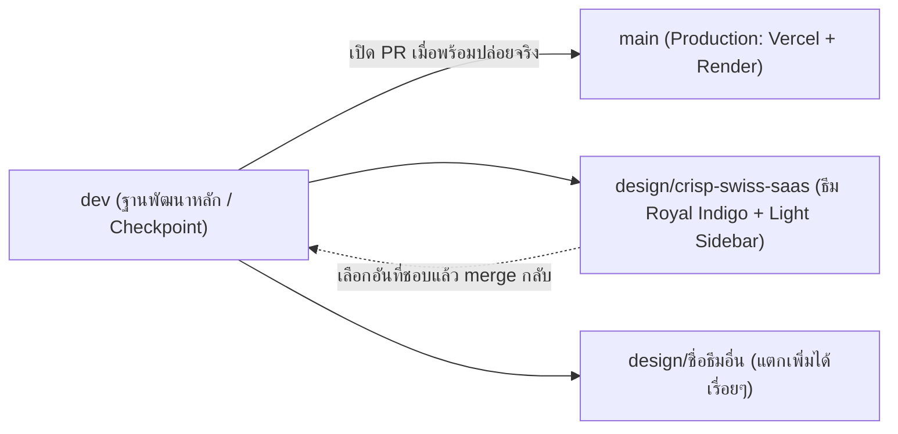

# คู่มือใช้ Git สำหรับโปรเจกต์ SEO Platform (ฉบับใช้งานจริง)

เอกสารนี้สรุปคำสั่ง Git ที่ใช้บ่อยในโปรเจกต์นี้แบบสั้นๆ ทำตามได้ทีละขั้น เหมาะสำหรับสลับดูดีไซน์ แตก branch ทดลอง และอัปขึ้น Production อย่างปลอดภัย

> **หมายเหตุสำหรับ PowerShell บน Windows:** ใช้เครื่องหมาย `;` คั่นคำสั่งแทน `&&`

---

## 1. โครงสร้าง Branch ของโปรเจกต์นี้



| Branch | หน้าที่ | ข้อควรระวัง |
|---|---|---|
| **`main`** | เว็บจริงที่ deploy อยู่บน **Vercel + Render** | ไม่แก้โค้ดตรงๆ บน branch นี้ ให้อัปผ่าน Pull Request จาก `dev` เท่านั้น |
| **`dev`** | ฐานพัฒนาหลักและจุด checkpoint ที่ทำงานได้ครบ | ใช้เป็นจุดตั้งต้นเวลาอยากแตก branch ทดลองใหม่ |
| **`design/crisp-swiss-saas`** | ทดลองธีมใหม่ (Royal Indigo + Collapsible Light Sidebar) | แก้และลองได้เต็มที่ ไม่กระทบเว็บจริง |

---

## 2. เช็กก่อนเริ่มทุกครั้ง (อยู่ Branch ไหน + มีไฟล์แก้อะไรบ้าง)

```powershell
git branch
```
- บรรทัดที่มีเครื่องหมาย `*` นำหน้า คือ branch ที่คุณกำลังยืนอยู่ตอนนี้

```powershell
git status -s -- src/
```
- ดูเฉพาะไฟล์โค้ดใน `src/` ที่มีการแก้ไข (ไม่ปนกับโฟลเดอร์เครื่องมือ/สกิลที่ไม่ได้ track)

---

## 3. สลับ Branch เพื่อเปรียบเทียบดีไซน์

ก่อนสลับ branch ตรวจสอบให้แน่ใจว่าไม่มีไฟล์แก้ค้างอยู่ (ถ้ามี ดูข้อ 7 เรื่อง `git stash`)

- **สลับไปดูธีมใหม่ (Royal Indigo):**
  ```powershell
  git checkout design/crisp-swiss-saas
  npm run build; npm run start
  ```
- **สลับกลับมาเทียบกับธีมเดิมบน `dev`:**
  ```powershell
  git checkout dev
  npm run build; npm run start
  ```
- **เปิดดูในเบราว์เซอร์:** เข้า `http://localhost:3000` (กด `Ctrl + 0` ให้ซูมเป็น 100% เพื่อเทียบขนาดจริง)

---

## 4. แตก Branch ใหม่เพื่อลองดีไซน์หรือฟีเจอร์อื่น

แนะนำให้เริ่มแตกจาก `dev` เสมอ เพื่อให้ฐานโค้ดสะอาดเหมือนกันทุกการทดลอง:

```powershell
git checkout dev
git checkout -b design/ชื่อที่ต้องการ
```

ตัวอย่างชื่อ branch ที่เข้าใจง่าย:
- `design/editorial-warm`
- `design/dark-minimal`
- `feat/seo-audit-v2`

---

## 5. เซฟงาน (Commit) และอัปขึ้น GitHub (Push)

> **สำคัญมาก:** **ห้ามใช้ `git add .`** ในโปรเจกต์นี้ เพราะในโฟลเดอร์มีไฟล์ตั้งค่าจาก `npx skills` ที่ไม่ควรเอาขึ้น Git ให้ระบุเฉพาะโฟลเดอร์ `src/` หรือชื่อไฟล์ที่แก้เท่านั้น

```powershell
# 1) เลือกเฉพาะไฟล์ที่ต้องการเซฟ
git add src/

# หรือระบุเป็นรายไฟล์ (ปลอดภัยที่สุด)
git add src/app/globals.css src/components/workspace-shell.tsx

# 2) เช็กดูว่าเลือกไฟล์ถูกไหม (ควรเห็นตัว M สีเขียวหน้าชื่อไฟล์)
git status -s -- src/

# 3) บันทึกเป็น Checkpoint พร้อมข้อความอธิบายสั้นๆ
git commit -m "style: ปรับขนาดปุ่มและสีหัวข้อหน้า dashboard"

# 4) ส่งขึ้น GitHub (ถ้าเป็น branch ใหม่ที่ยังไม่เคย push ให้ใส่ -u origin ชื่อbranch)
git push -u origin ชื่อbranchปัจจุบัน
```

*ครั้งต่อๆ ไปบน branch เดิมที่เคย push แล้ว ใช้แค่ `git push` สั้นๆ ได้เลย*

---

## 6. เมื่อเลือกดีไซน์ที่ชอบได้แล้ว — เอากลับเข้า `dev` และขึ้น `main`

### ขั้นที่ 1: รวม branch ดีไซน์ที่เลือกเข้า `dev`
วิธีที่ง่ายและปลอดภัยที่สุดสำหรับมือใหม่คือทำผ่าน **GitHub Pull Request**:
1. เปิด GitHub repo `Natnicha-Sohmalee/seo-platform-demo`
2. กดแท็บ **Pull requests** → **New pull request**
3. ตั้งค่า:
   - **base:** `dev`
   - **compare:** `design/crisp-swiss-saas` (หรือ branch ที่คุณเลือก)
4. ตรวจดูรายการไฟล์ → กด **Create pull request** → **Merge pull request**
5. กลับมาที่เครื่องแล้วดึงอัปเดตล่าสุดลง `dev`:
   ```powershell
   git checkout dev
   git pull origin dev
   ```

*(หรือถ้าอยากรวมผ่าน terminal โดยตรง:)*
```powershell
git checkout dev
git merge design/crisp-swiss-saas
git push origin dev
```

### ขั้นที่ 2: ปล่อยขึ้นเว็บจริง (`main` → Vercel + Render)
ทำเหมือนเดิมบน GitHub Pull Request โดยตั้งค่า:
- **base:** `main`
- **compare:** `dev`
- กด **Merge pull request** → Vercel และ Render จะ build และอัปเดตเว็บจริงให้อัตโนมัติ

---

## 7. คำสั่งกู้ชีพ (เวลาติดขัดหรือแก้พลาด)

### สลับ branch ไม่ได้ เพราะมีไฟล์แก้ค้างอยู่
เก็บงานที่แก้ค้างไว้ชั่วคราวด้วย `stash` แล้วค่อยดึงกลับมาทีหลัง:
```powershell
# ซ่อนงานที่แก้ค้างไว้ชั่วคราว
git stash push -- src/

# สลับไปดู branch อื่นได้ตามปกติ
git checkout dev

# พอกลับมา branch เดิม อยากเอางานที่ซ่อนไว้กลับมา:
git checkout design/crisp-swiss-saas
git stash pop
```

### แก้ไฟล์หนึ่งพัง อยากย้อนเฉพาะไฟล์นั้นกลับไปเหมือน commit ล่าสุด
```powershell
git checkout -- src/app/globals.css
```

### อยากดูประวัติ Checkpoint ที่เคยเซฟไว้ (5 อันล่าสุด)
```powershell
git log -n 5 --oneline
```

### ลบ branch ทดลองที่ไม่ได้ใช้แล้ว (หลังเลือกอันที่ชอบแล้ว)
```powershell
# ลบในเครื่อง (ต้องสลับไปอยู่ dev ก่อน)
git checkout dev
git branch -d design/ชื่อbranchที่ไม่ใช้

# ลบบน GitHub (ถ้าเคย push ขึ้นไปแล้ว)
git push origin --delete design/ชื่อbranchที่ไม่ใช้
```
