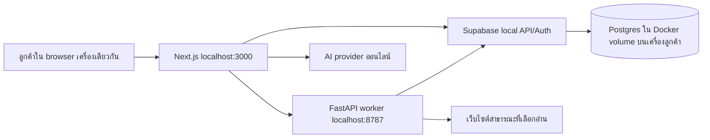
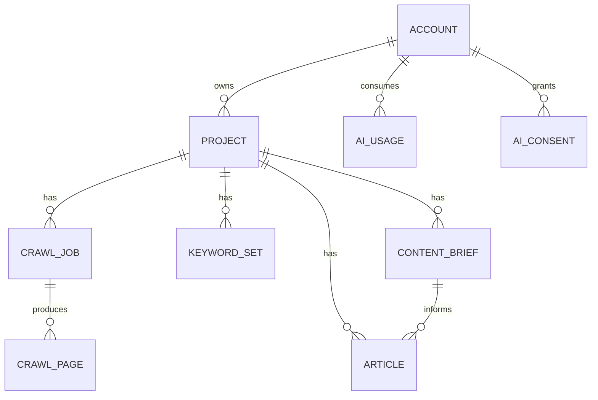

# System design: local SEO Platform pilot

## เป้าหมายและขอบเขต

ลูกค้าจริงหนึ่งธุรกิจทดลองใช้ระบบเองทุกขั้นตอนภายในสองสัปดาห์ ทีมติดตั้งครั้งแรกบนเครื่อง Windows ของลูกค้า โดยรัน Linux ผ่าน WSL และ Docker ข้อมูลเป็นข้อมูลทดลองที่เริ่มใหม่ได้ ฐานข้อมูลอยู่ในเครื่องลูกค้า AI API ใช้คีย์ทดลองของทีมและเชื่อมอินเทอร์เน็ต ลูกค้าทดลองทั้งเส้นทางมีเว็บไซต์และไม่มีเว็บไซต์จนได้บทความที่แก้ไข บันทึก เปิดต่อ และส่งออกได้ ทีมเลือก AI provider ผ่าน server env ตอนติดตั้ง ไม่ให้ลูกค้าสลับจากหน้าเว็บ

ผลลัพธ์สุดท้ายคือไฟล์ Markdown ที่ลูกค้านำไปเผยแพร่เองภายนอกระบบ รอบนี้ไม่เชื่อม WordPress/CMS และไม่มีขั้นอนุมัติบทความในระบบ

หนึ่งธุรกิจใช้หนึ่งบัญชีผู้ใช้ งานทุกชิ้นอยู่ภายใต้โปรเจกต์ เว็บไซต์ของโปรเจกต์เป็นข้อมูลทางเลือก การเปิดงานเดิมต้องไม่เรียก AI ใหม่ หากจะส่งข้อมูลจริงให้ AI ต้องแจ้งว่าข้อมูลใดจะถูกส่งไปยัง provider ใดและขอความยินยอมก่อน

## สภาพปัจจุบันของ branch `system-design`

| ส่วน | มีแล้ว | ช่องว่างที่กระทบ pilot |
| --- | --- | --- |
| เว็บ | Next.js, login, โปรเจกต์, หน้า keyword/brief/article | สร้างโปรเจกต์บังคับ URL; งานเนื้อหายังไม่ผูก `project_id` |
| ข้อมูล | Supabase Auth, ตาราง `projects`, `crawl_jobs`, `crawl_pages`, `content_briefs`, `articles` ผ่าน client/RLS | ไม่มี SQL migration ใน repo; ยังตั้งค่า local stack และ bootstrap บัญชีไม่ได้ |
| Crawl | FastAPI worker บันทึกสถานะ/หน้าลง Supabase; UI ติดตามผล | worker ตรวจ `SUPABASE_URL` เป็น HTTPS เท่านั้น; local API เป็น HTTP; งานค้างหลัง restart ได้ |
| AI | Typhoon/Gemini เลือกผ่าน server env; สร้างหัวข้อ/แผน/บทความ | ยังไม่มีเพดานการเรียก, consent และบันทึกการใช้; คีย์ทีมอยู่บนเครื่องลูกค้า |
| ติดตั้ง | README สำหรับ dev บน Windows | ยังไม่มีชุดติดตั้ง WSL/Docker, start/stop, health check และคู่มือส่งมอบลูกค้า |

## สถาปัตยกรรมเป้าหมายสำหรับ pilot

ใช้ Supabase CLI local stack สำหรับ pilot ที่ใช้ข้อมูลทดลองเท่านั้น เพื่อรักษา Auth/PostgREST/RLS และลดการเขียน storage layer ใหม่ [เอกสาร Supabase ระบุว่า local stack ต้องใช้ container runtime](https://supabase.com/docs/guides/local-development) และ [ไม่ใช่ระบบ production](https://supabase.com/docs/guides/local-development/restoring-downloaded-backup) ห้ามใช้ `supabase db reset` หรือ `supabase stop --no-backup` กับข้อมูลที่ต้องเก็บ เมื่อจะเปิดบริการจริงต้องประเมิน hosting, backup/restore, monitoring และการจัดการบัญชีใหม่

บน Windows เปิด browser ที่ `http://localhost:3000`; Next.js, worker และ Supabase รันใน WSL/Docker โดย bind บริการให้เข้าถึงเฉพาะเครื่องนี้ ค่า URL ระหว่าง process ต้องทดสอบจริงใน WSL/Docker ทั้งหมด ไม่สมมติว่า `localhost` ของ container เท่ากับ host

## โมเดลข้อมูลเป้าหมาย

- `projects.website_url` nullable; โปรเจกต์ไม่มี URL ยังสร้าง brief/บทความได้ แต่ปุ่ม crawl ใช้ได้เมื่อมี URL
- ชุดคีย์เวิร์ด, แผนบทความ และบทความมี `project_id` จริงในตาราง; ไม่ใช้ prefix ของ `storage_key` เป็นหลักฐานความเป็นเจ้าของโปรเจกต์
- RLS จำกัดการอ่าน/เขียนด้วยเจ้าของโปรเจกต์; worker ใช้ server secret เฉพาะใน process ฝั่ง server และบันทึกผลของ job ที่สร้างไว้แล้ว
- `crawl_pages` ใช้ unique (`crawl_job_id`, `url`); เอกสารเนื้อหาใช้ `version` ป้องกันการเขียนทับงานจากแท็บอื่นตามโค้ดเดิม
- ตารางบันทึกการใช้ AI เก็บบัญชี, action, เวลา, สถานะ และจำนวนครั้งที่นับ โดยไม่เก็บ prompt หรือคีย์; ใช้ transaction/ข้อจำกัด DB เพื่อจองสิทธิ์ก่อนเรียก AI พร้อมกัน
- หลักฐานความยินยอมเก็บบัญชี, provider, ประเภทข้อมูลที่อนุญาต และเวลา; การเปลี่ยน provider ต้องขอความยินยอมใหม่เมื่อใช้ข้อมูลจริง
- งานเดิมจาก browser/Supabase ภายนอกไม่อยู่ในขอบเขตการย้ายสำหรับเครื่อง pilot ใหม่; ห้ามลบข้อมูลเดิมใน branch หรือบัญชีอื่นโดยอัตโนมัติ

## เส้นทางใช้งานที่ต้องผ่าน

1. ทีมติดตั้ง local stack, รัน migration, ตั้ง env, สร้างบัญชีลูกค้าหนึ่งบัญชี และตรวจ health ของเว็บ/worker/DB
2. ลูกค้าสร้างโปรเจกต์ **มีเว็บไซต์** → crawl → ดูหน้าและ SEO audit → เลือกแหล่งข้อมูล → สร้างแผนบทความ → สร้างบทความ → แก้ บันทึก เปิดใหม่ ส่งออก Markdown
3. ลูกค้าสร้างโปรเจกต์ **ไม่มีเว็บไซต์** → กรอกรายละเอียดธุรกิจ → สร้างแผนบทความ → สร้างบทความ → แก้ บันทึก เปิดใหม่ ส่งออก Markdown
4. ลูกค้านำเข้า CSV เป็นชุดคีย์เวิร์ดในโปรเจกต์ แล้วใช้คำที่เลือกกับหนึ่งในสองเส้นทาง โดยแสดงที่มา/ช่วงข้อมูลตามไฟล์ ไม่อ้างว่าเป็นข้อมูลล่าสุด
5. ก่อนเรียก AI แสดง provider, ประเภทข้อมูลที่จะส่ง และบันทึกการยินยอมเมื่อมีข้อมูลจริง; เมื่อเกินเพดานให้หยุดก่อนส่ง request และแสดงจำนวนสิทธิ์คงเหลือ

## ขอบเขตการทำงานและความล้มเหลว

- Worker รับ crawl ได้ครั้งละหนึ่งงานตามโค้ดปัจจุบัน; UI ต้องบอกเหตุผลเมื่อคิวเต็มและให้ลองใหม่ ไม่เพิ่มคิวถาวรใน pilot
- ตั้งเพดาน AI จาก config สำหรับบัญชี pilot (ค่าเริ่มต้นเสนอ 20 คำขอต่อวันและ 100 คำขอตลอด pilot; lead ปรับได้ก่อนส่งมอบ) นับความพยายามที่ส่งถึง provider แม้ provider ตอบผิดพลาด เพื่อคุมปริมาณการใช้
- รองรับสอง profile ที่ทีมเลือกตอนติดตั้ง: **Gemini** ใช้คีย์/โปรเจกต์เฉพาะ pilot และ [project spend cap](https://ai.google.dev/gemini-api/docs/billing/) ร่วมกับเพดานในแอป; **Typhoon** ใช้คีย์เฉพาะ pilot และเพดานในแอปเป็นหลัก พร้อมตรวจ usage/ถอดคีย์เมื่อจบ [rate limit ของ Typhoon](https://docs.opentyphoon.ai/en/rate-limits/) จำกัดความถี่ ไม่ใช่เพดานการใช้รวมหรือค่าใช้จ่ายที่ตั้งเองได้ตามหลักฐานที่พบ
- คีย์ AI และ Supabase secret อยู่บนเครื่องลูกค้า จึงถือว่าผู้ดูแลเครื่องเข้าถึงได้ ทีมต้องใช้คีย์เฉพาะ pilot จำกัดการใช้เท่าที่ provider รองรับ และเพิกถอนเมื่อจบ
- การ crawl ตรวจ URL สาธารณะและ robots ตามโค้ดเดิม; ไม่ถือผลตรวจ SEO หรือข้อความจาก AI เป็นการรับรองข้อเท็จจริงหรืออันดับ
- เมื่อต้องหยุด/รีสตาร์ตระหว่าง crawl ต้องแสดงงานค้างอย่างชัดเจนและให้เริ่มงานใหม่ได้โดยไม่ทำให้ข้อมูลในโปรเจกต์เสีย
- รอบ pilot ไม่ทำ backup เพราะข้อมูลทดลองเริ่มใหม่ได้; เอกสาร production ต้องระบุ backup/restore, สิทธิ์ข้อมูล, คิวถาวร, การจำกัดการใช้ และ deployment ที่ไม่พึ่งเครื่องลูกค้า
- ลูกค้านำ Markdown ที่ส่งออกไปเผยแพร่เอง; การเชื่อมต่อ CMS และ workflow อนุมัติบทความอยู่นอกขอบเขต pilot

## เกณฑ์ส่งมอบ

- ติดตั้งจาก clone ใหม่บนเครื่องเป้าหมายได้โดยทำตามคู่มือและใช้ข้อมูลตัวอย่าง ไม่มีขั้นตอนที่ต้องเดา schema หรือ URL
- ลูกค้าทำสองเส้นทางข้างต้นได้เองหลังทีมติดตั้ง และเปิดงานที่บันทึกไว้ต่อได้หลัง restart โดยไม่เรียก AI เอง
- ไม่มีการส่ง prompt ก่อนยินยอมเมื่อใช้ข้อมูลจริง; เมื่อครบเพดาน AI ไม่มี request ไป provider
- ทีมทดสอบทั้งสอง AI profile ในสภาพแวดล้อมพัฒนา และทดสอบ profile ที่เลือกจริงบนเครื่องลูกค้า; หน้าจอแสดงชื่อ provider ก่อนส่งข้อมูล
- ทดสอบ RLS ว่าบัญชีอื่นอ่าน/แก้โปรเจกต์และงานของลูกค้าไม่ได้ แม้ pilot ใช้จริงเพียงบัญชีเดียว
- ทดสอบกรณี worker ไม่พร้อม, AI 429/timeout, URL crawl ถูกปฏิเสธ และงาน crawl ค้างหลัง restart; UI อธิบายทางไปต่อได้
